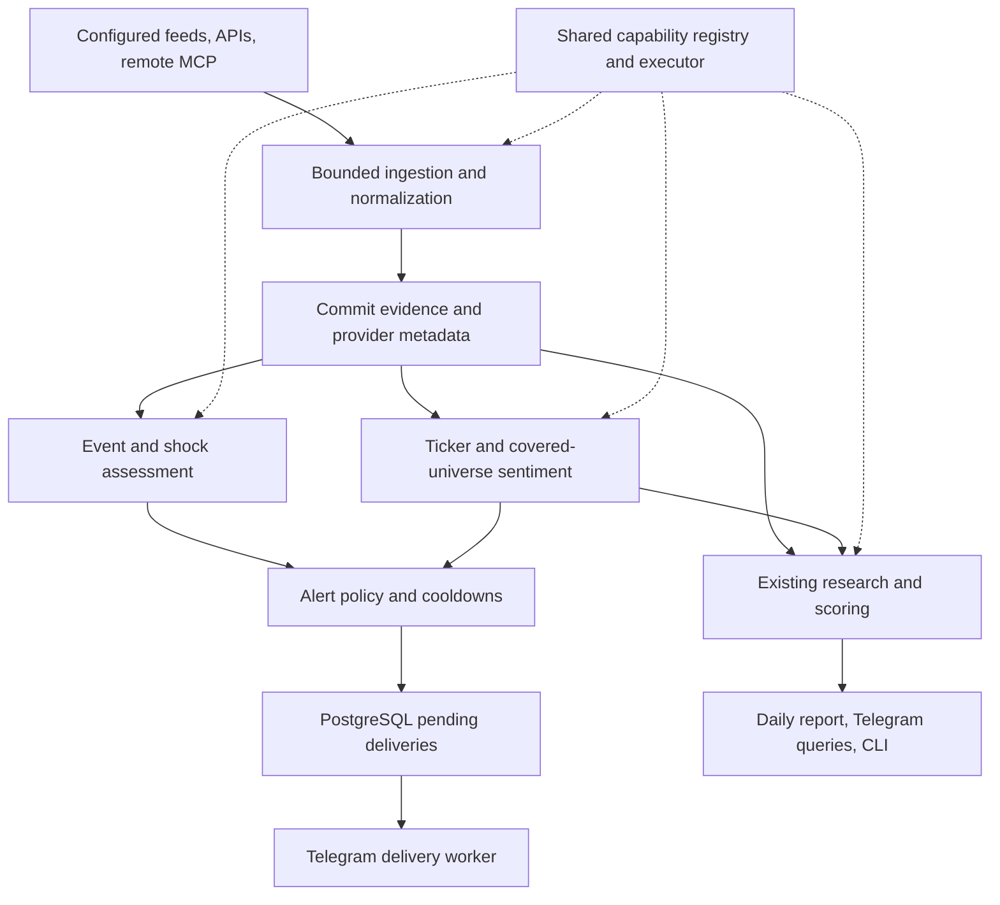

# Unified plan: architecture migration, shock alerts, and sentiment

Status: original combined roadmap, 2026-10-22; implementation authorized 2026-10-30,
superseding the earlier hold. The Jev alert pipeline and shared harness are implemented
on `feat-build-alerts`, with PostgreSQL, controlled MCP, and isolated live Jev validation.
Production deployment and real Telegram delivery have not been validated. See the
[alert runbook](../README.md#market-news-and-sentiment-alerts), [current harness documentation](harness.md),
and [evaluation report](../reports/eval/market_alert_eval_comparison_20261031.md).
The roadmap and repository observations below retain the original design baseline.
Existing supported commands, memory, general web questions, and quiet refresh diagnostics
remain part of the product.

## Recommendation and current gaps

Keep LangGraph, PostgreSQL, and the existing domain services. Migrate to the planned shared
capability executor, then deliver two market-alert types through a durable delivery path:
**material breaking events** and **sustained sentiment changes**. Both feed the existing
18:00 America/Toronto daily research report.

| Current repository evidence | Required change |
| --- | --- |
| [MarketImpactClassifier](../src/news_agent/ingestion/market_impact.py#L12) judges market relevance; its confidence explicitly does not measure impact magnitude. | Reuse the relevance gate; add a distinct event/materiality decision for urgent alerts. |
| [Settings](../src/news_agent/settings.py#L139) defaults to a 60-second tick, 30-minute breaking pipeline, and [per-source intervals](../src/news_agent/settings.py#L186); [ticks await complete refreshes](../src/news_agent/scheduler/service.py#L135). | A fast detection/delivery lane needs independent scheduling and per-source overrides; lowering one interval is insufficient. |
| [Alpha Vantage](../src/news_agent/ingestion/providers.py#L82) captures sentiment, but [article persistence](../src/news_agent/graph/nodes.py#L675) omits it. [MarketMention.sentiment](../src/news_agent/storage/models.py#L171) is unused. | Persist ticker-specific sentiment and provenance before producing aggregate snapshots. |
| [Runtime alerts](../src/news_agent/observability/runtime.py#L117) describe operational failures; [daily reports](../src/news_agent/scheduler/reports.py#L23) have locks and delivery checkpoints. | Give market alerts their own event identity, recipient policy, cooldowns, and durable pending-delivery records. Reuse Telegram transport/checkpoint patterns. |

## Target architecture

Preserve the proposed typed Python registrations, versioned TOML configuration, environment
secret references, bounded subagents, and remote MCP in the initial harness release.
Telegram, scheduler, CLI, and evaluation use the same structured results and policy boundary.
The executor owns permissions, budgets, deadlines, and concurrency; models can summarize
evidence but cannot choose recipients or authorize delivery. Parallel reads use separate
database sessions. Evidence writes, decisions, and delivery remain explicitly ordered.

Keep the two existing application processes. Within the scheduler, fast collection and
pending-delivery dispatch have bounded tasks and scoped database coordination independent
of bulk enrichment, memory, and daily reports. They must not wait behind the current global
refresh exclusion. Bulk summaries/embeddings run after committed evidence; urgent decisions
do not wait for the [full research graph](../src/news_agent/graph/scheduler_graph.py#L35).
PostgreSQL provides coordination and pending work; no new broker is required initially.

## Research findings and source choices

| Source | Role and constraint |
| --- | --- |
| Approved publisher/issuer feeds and SEC disclosures | First fast-source pilot: measure actual publication and availability delays. SEC's [submissions API](https://www.sec.gov/search-filings/edgar-application-programming-interfaces) updates as filings disseminate; fair-access rules apply. It covers filings, not all breaking news. A broader latency guarantee requires a separately verified news-feed service level. |
| Massive/Polygon | Reuse the existing adapter for article-linked ticker sentiment. Its [news endpoint](https://massive.com/docs/rest/stocks/news?assetClass=stocks&license=personal&name=stocks_basic) includes optional sentiment insights and is documented as hourly, including Basic Free. It cannot be the sole urgent-news trigger. |
| Alpha Vantage | Reuse existing sentiment only if entitled; current [NEWS_SENTIMENT documentation](https://www.alphavantage.co/documentation/#news-sentiment) marks the endpoint Premium. Preserve vendor scores/labels rather than inventing probabilities. |
| Stocktwits remote MCP | Candidate retail-opinion source through the initial remote adapter. The [official guide](https://help.stocktwits.com/c/key-features-of-stocktwits/key-features-of-stocktwits/connect-ai-assistant) documents account authorization and community sentiment at `https://mcp.stocktwits.com/mcp`. Validate actual tools, quotas, renewable unattended authorization, and permitted Telegram use before enabling it. |
| FRED VIXCLS / AAII | Optional dated market context: [VIX](https://fred.stlouisfed.org/series/VIXCLS) measures expected volatility; [AAII](https://www.aaii.com/sentimentsurvey/sent_results) is a weekly survey. Keep them distinct from news tone and retail activity. Data-access rights do not establish redistribution rights. |

Use the [official MCP Python SDK](https://github.com/modelcontextprotocol/python-sdk), pinned
to a tested release, with Streamable HTTP, allowlisted tools, schema validation, credential
isolation, and compatibility tests against the selected server. Headless jobs must return
an unavailable status when authorization expires; they cannot pause for interactive login.
Optional MCP failures leave local research usable. Provider coverage, account entitlements,
and redistribution permissions remain implementation prerequisites, not assumed purchases.

## Alert and sentiment behavior

**Shock news:** identify a fresh, material event such as bankruptcy, a major regulatory
action, acquisition, or explicitly evidenced guidance change. Store event scope (ticker,
sector, or broad market), severity, evidence confidence, source links, and timestamps.
Urgency requires either a verified primary source or independent corroboration. A keyword,
source-category match, price move, or extreme sentiment alone cannot establish a shock.
Call something an earnings/guidance surprise only when comparison evidence exists.

Cluster syndicated stories into one event. Notify once per event and destination; send a
new revision only for material new facts, escalation, or a correction. Suppress stale items
and startup/backfill floods. A correction is attached to the original event and gets an
explicit follow-up when a prior alert was sent. The alert states what happened, affected
entities, why it is material, publication/detection times, evidence, and remaining uncertainty.
Assign a stable event ID after reconciliation. Match on entity/scope, event type, occurrence
window, and event-specific identifiers such as filing accession, counterparty, or regulator/case.
Evidence IDs are supporting links, not identity components. Persist aliases/merges and
monotonic revisions; another provider must not create a new event. Test conflicting and reordered stories.

**Sentiment:** begin with provider-supplied, per-ticker news labels. Keep positive/negative/
neutral shares, coverage, disagreement, observation window, provider/version, and evidence.
Deduplicate stories and cap repeated coverage of one event. Compute separate provider series
until their scales are validated. The wider news view is labeled **covered-universe news
tone**, with coverage disclosed; it is not presented as representative investor consensus.
Retail bullish/bearish ratios and volatility retain their own units and histories.
First rollout alerts on **per-ticker news-tone changes**. Stocktwits starts as a separate
shadow series; VIX/AAII are dated daily-report context. Each later alert series needs its own
validated baseline, threshold, coverage requirement, and cooldown.

A sentiment alert requires minimum independent coverage, a valid comparable prior window,
a configured change threshold sustained across two newly observed provider batches, and a
cooldown. Start with a rolling 24-hour window versus its preceding 24 hours, using publication
time for membership and first-seen time to determine availability at the decision's fixed
`as_of`. Record exact bounds, counts, and data watermark. Late/revised items can update history
and daily coverage but cannot retroactively trigger a fresh alert. Missing/stale data,
provider outages, provider/model changes, and a new baseline suppress change alerts and record gaps.
Neutral and mixed opinions remain distinguishable. Sentiment is descriptive context alongside
the existing attention score; it does not increase ranking automatically.

**Delivery:** require an explicitly configured market-alert destination, separate from
operator alerts; do not infer the latest chat. Commit a decision and its pending-delivery
record together, with database uniqueness on `(decision_id, revision, kind, destination)`.
Claim work using database locking/leases, freeze the payload, checkpoint accepted messages,
and bound attempts. A crash or timeout can leave Telegram acceptance unknown: record that
state without automatic resend, including expired in-flight attempts. This trades possible
missed alerts for fewer duplicates;
exactly-once Telegram delivery is not promised. Reuse chunking and transport code without
putting urgent alerts under the daily-report lock.

Configure enabled alert types, destination, source/universe scope, polling/freshness bounds,
coverage/change thresholds, cooldowns, quiet hours, critical-event override, and rate caps
through the existing settings-to-TOML resolution. Quiet hours default to no suppression for
confirmed critical events; all defaults and overrides must be visible in effective config.
Daily reports combine candidates, important events, sentiment changes, and data gaps at the
existing configurable 18:00 America/Toronto schedule. Ordinary refreshes stay quiet.

## One migration sequence

| Phase | Change boundary | Exit condition |
| --- | --- | --- |
| 1. Shared foundations, including remote MCP | Begin the [harness migration](stock-news-harness-proposal.md#proposed-implementation-sequence--not-authorized-to-execute-yet): contracts/config/registry, shared runner, MCP adapter, and compatibility adapters for existing commands. | C1–C3, P1–P4, and M1–M3 pass: configuration, permissions, mixed local/remote execution, budgets, and ordered effects. Existing public behavior remains covered. |
| 2. Evidence, decisions, and final channel wiring | Add Alembic migrations for sentiment provenance, reconciled event identities/revisions, sentiment snapshots, and pending deliveries. Reuse the existing mention field where semantics match. Then wire the final results once across Telegram/scheduler/CLI/evaluation. | H1–H3 pass alongside duplicate/multi-company replay: equivalent structured results, retained attribution, no ticker leakage/repeated votes, and compatible historical data with unknown sentiment. |
| 3. Fast monitoring in shadow mode | Separate collection/dispatch scheduling from bulk work; register deterministic event assessment, sentiment aggregation, and alert-policy capabilities. Evaluate but do not send market alerts. | Replay establishes thresholds and coverage; overload, stale/backfilled inputs, corrections, provider outages, and overlapping schedulers behave as specified. |
| 4. Controlled Telegram rollout | Enable configured recipients and alert types; enrich daily reports and `/signals`; expose delivery/decision traces through runtime inspection. | All C1–H3 and alert gates pass, including cooldowns, quiet hours, restart recovery, unknown outcomes, and report resumption. Rollback disables market delivery while preserving evidence and prior public interfaces. |

## Verification and remaining limits

- Proposed fast-lane target: p95 within **two minutes of an item becoming available to an
  approved connector**, using an initial 60-second poll where quotas permit. Measure publisher
  time, provider availability where observable, first-seen, decision, and delivery separately.
  Validate observed production latency; do not present replay timing as a publisher SLA.
- On labeled replay data, require at least **90% precision** for urgent-event decisions;
  report recall and missed-event categories. Include non-events, rumours, negation, corrections,
  stale reprints, macro events, and multi-company stories. Review sentiment label quality and
  coverage separately; no historical baseline means no sentiment-change alert.
- Deterministic tests cover clock/window boundaries, duplicate revisions, two schedulers,
  source/provider loss, bounded queues, concurrency isolation, and delivery uncertainty.
  PostgreSQL integration tests prove migration, uniqueness, claim, and restart behavior.
- Run the full pytest suite and Ruff after implementation. No dedicated type checker is
  configured. Prompt changes also require the existing [isolated live evaluation](market-research/evaluation.md).

This report is based on repository inspection and official documentation, not authenticated
feed tests. No application code, dependency, database, or running service was changed.
Reliable source latency and permitted downstream distribution are the main external limits;
sentiment quality and shock thresholds require measured evaluation before live delivery.
