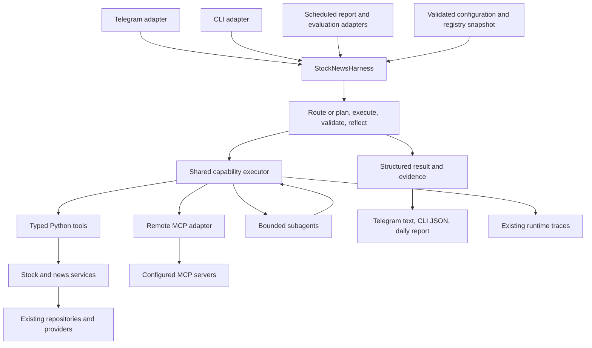

# Proposal: a configurable stock-and-news agent harness

Status: historical architecture proposal, 2026-09-21. The user authorized implementation
on 2026-10-30, superseding the earlier hold. The shared harness, including remote MCP,
is implemented on `feat-build-alerts`; see [current harness documentation](harness.md)
and the [alert runbook](../README.md#market-news-and-sentiment-alerts) for supported behavior.
The observations and proposed interfaces below describe the original design baseline.

The [unified migration and market-alert plan](market-intelligence-migration-plan.md) is the
current combined roadmap as of 2026-10-22. This document supplies its detailed harness
contracts and C1–H3 acceptance criteria; shock-news and sentiment delivery use that shared core.

## Recommendation

Keep LangGraph for the outer request lifecycle and introduce one shared capability registry
and executor underneath it. Python tools, remote MCP tools, and bounded subagents use the
same invocation contract. Keep market/news evidence, scoring, storage, ingestion, and report
formatting in the existing domain modules. Telegram, scheduled jobs, and a CLI become
adapters around the same research core.

Here, **harness** means the environment that runs an agent: configuration, available tools,
context and permissions, execution budgets, parallel scheduling, evidence validation,
memory, tracing, and output handling. It is a research product; order execution and
investment recommendations remain outside its boundary.

| Requirement | Proposed result |
| --- | --- |
| Whole agent configurable; easy tool additions | A versioned TOML configuration resolved into typed settings; one registration for a Python tool; config and discovery for an MCP tool; configured subagent tool subsets and budgets. |
| Parallel tools and subagents | One executor schedules independent calls with bounded concurrency, ordered results, dependencies, deadlines, cancellation, and write barriers. |
| Stock-and-news harness | Shared market/news capabilities and evidence contracts, callable from Telegram, daily reports, CLI, and evaluation. |
| Remote MCP from the start | A protocol-aware client adapter with authentication, tool discovery, schema validation, allowlists, and the same execution and reporting rules as local tools. |

## What the repository already provides

These are observations of the worktree at proposal time; recommendations below are design judgments.

| Evidence | Architectural implication |
| --- | --- |
| [Tool](../src/news_agent/agent/tools.py#L20) has a name, manual JSON schema, and variadic callable; [dispatch](../src/news_agent/agent/main_agent.py#L150) branches on tool names. | Adding a tool currently requires knowledge of central dispatch. Move argument/context adaptation into its registration. |
| [MainAgent](../src/news_agent/agent/main_agent.py#L136) awaits each returned tool call in sequence. [ResearchSubagent](../src/news_agent/research/agents.py#L412) has a second schema list and serial tool loop. | Share scheduling and validation instead of adding separate parallel implementations. |
| [CompanyResearchCoordinator](../src/news_agent/research/orchestration.py#L49) already bounds fan-out, company and total timeouts, and preserves result order. | Reuse its behavior and regression contracts when generalizing execution. |
| [Research planning](../src/news_agent/research/planner.py#L35) lists agents to run, but [execution](../src/news_agent/research/agents.py#L145) uses that list as trace metadata. | Do not mistake named planning stages for an implemented multi-agent dispatcher. |
| [SupervisorNodes](../src/news_agent/app/supervisor.py#L70) constructs every agent directly; [routing](../src/news_agent/app/supervisor.py#L45) chooses one command target. | Configuration must affect direct commands, fallbacks, and reflection, not only model-visible tools. |
| [Research execution](../src/news_agent/research/agents.py#L193) extracts, scores, backfills, and prunes for `/research`; [retrieval](../src/news_agent/research/agents.py#L268) can also persist link checks. | Existing research is not uniformly read-only. Parallelizing the whole subagent without separating effects is unsafe. |
| [Settings](../src/news_agent/settings.py#L40) already controls models, provider behavior, scoring, memory, scheduling, and reports. | Preserve these controls and consolidate resolution; avoid a competing configuration system. |
| [Chat context](../src/news_agent/app/supervisor.py#L89) and [persistence](../src/news_agent/app/supervisor.py#L300) require Telegram IDs. [User](../src/news_agent/storage/models.py#L35) and [ShortTermSession](../src/news_agent/storage/models.py#L226) also encode that assumption. | A reusable core needs a transport-independent request and explicit persistence adapter. Merely renaming the supervisor would not satisfy the harness requirement. |
| [Daily reporting](../src/news_agent/scheduler/reports.py#L121) separately composes candidate retrieval, evidence checks, and formatting. | Make it a consumer of the same research capability while preserving sequential delivery checkpoints. |

## Alternatives considered

| Option | Benefit | Cost / limitation | Decision |
| --- | --- | --- | --- |
| Keep LangGraph; share a registry/executor and domain services | Incremental migration; preserves commands, reflection, memory and runtime traces; local and remote tools share controls. | We own the small execution policy layer. | **Recommended.** It directly addresses the duplicated loops above. |
| Migrate orchestration to OpenAI Agents SDK | Existing [agent orchestration](https://developers.openai.com/api/docs/guides/agents/orchestration) and [MCP integrations](https://developers.openai.com/api/docs/guides/agents/integrations-observability) could replace some custom loop code. | Requires remapping graph behavior, custom memory, traces, deterministic commands, and evaluation. A migration alone does not define stock/news evidence or safe write ordering. | Reconsider only if a compatibility spike shows a clear net reduction after those integrations. |
| Replace the outer graph with a plain async application service | Fewer orchestration abstractions. | Would rebuild existing lifecycle/reflection wiring while still needing the registry, MCP adapter, and scheduler. | No demonstrated benefit for this change. |

The recommendation is based on this repository's integration cost, not a claim that one
framework is universally better. No broker, distributed agent service, or plugin marketplace
is required for the initial harness.

LangGraph already documents [parallel workflows and worker aggregation](https://docs.langchain.com/oss/python/langgraph/workflows-agents).
Use those outer-workflow primitives where they help, while giving the shared executor sole
ownership of capability policy and invocation. Do not run graph fan-out and a second tool
scheduler over the same calls. Ingestion remains its existing deterministic batch graph;
only explicit authorized refresh operations bridge from the harness into that pipeline.

## Target shape



The subagent-to-executor edge is bounded delegation, not unrestricted recursion. Subagents
return results to their parent; only the parent composes the final answer. The core does not
send Telegram messages or start background ingestion as an incidental effect of answering.
Default to deterministic tools for retrieval and one research planner/synthesizer; add a
specialist subagent when its distinct reasoning task needs a separate prompt and tool subset,
not for every repository query. Configured independent specialists can still run together.

### Contracts and ownership

| Contract | Required contents / ownership |
| --- | --- |
| `HarnessRequest` | Query or named operation, input data, profile, optional session reference, output preference. CLI and scheduled callers do not need synthetic Telegram IDs. |
| `RunContext` | Trusted principal and allowed capabilities, optional user-memory scope, run/parent IDs, fixed research `as_of`, deadline, shared budget, immutable configuration/registry versions. Context is injected by the host, never accepted from model tool arguments. |
| `CapabilitySpec` | Stable ID, kind (`python`, `mcp`, `subagent`), input/output schema, handler, effect classification, timeout, retry policy, concurrency group, required capability. |
| `ToolCall` | Call ID, capability ID, validated arguments, explicit dependency IDs if a deterministic plan supplies them. |
| `ToolResult` | Call ID, status, structured data, evidence references, warnings, retryability, duration and usage; distinguish invalid arguments, denial, unavailability, timeout, failure and unknown write outcome. |
| `ResearchResult` | Candidate/company findings, claims linked to evidence, freshness and coverage gaps, provenance, and partial-failure information; rendering is separate. |

Use existing Pydantic for local argument/result validation and ordinary Python registration:
one handler accepting `(validated_arguments, context)`, one registration, and a focused test.
Generate the model-facing schema from that registration. Adding a tool must not require
another `if tool_name == ...` in either agent loop. A subagent is a registered capability
whose handler runs a configured model/prompt/tool subset, rather than a new supervisor branch.

Existing [research dataclasses](../src/news_agent/research/schemas.py#L112) already model
candidate explanations, company packets, financial facts and evidence. Evolve those
contracts rather than inventing a second financial-data model.

### Configuration

Use `harness.toml`, parsed with Python's `tomllib` and validated with Pydantic. Resolve one
immutable effective configuration per process startup/run. Proposed precedence, low to
high: existing defaults, base file, named profile, documented environment overrides.
CLI flags select a file/profile and presentation options; they do not override permissions.
Environment variables remain the only configuration references to secret values.

| Configuration area | Controls |
| --- | --- |
| Models and prompts | Registered model driver, per-agent model, prompt file/revision, model parameters, tool schema compatibility. Default driver wraps the existing OpenAI integration; adding a driver is code, not an arbitrary import string. |
| Tools and agents | Enabled registrations, tool subsets, delegation relationships/depth, domain permissions, timeouts, concurrency groups and retry limits. Cyclic delegation is rejected at startup. |
| Research and ingestion | Existing provider/source, universe, evidence, score, extraction and retention settings; freshness bounds and source eligibility. |
| Memory and session | Read/write enablement, user scope, context limits, retention and consolidation policy. |
| Execution and operations | Total deadline, model turns and token budgets, total calls, active leaf calls, provider limits, result sizes, trace redaction and fallback rules. |
| Reports and channels | Existing daily-report enablement, 18:00 America/Toronto schedule, recipient, candidate count and Telegram chunking; CLI structured/text output. |
| MCP connections | Named endpoint reference, authentication mode, required/optional status, allowed tools, approved effect classification, request/result limits and discovery refresh. |

Configuration selects trusted registrations; it does not load arbitrary Python modules or
let remote tool descriptions modify host instructions. Profiles can only narrow the host's
permission ceiling. A disabled capability stays disabled in direct commands, main-agent
fallback, reflection repair, subagent delegation, CLI, and scheduled requests.

Separate **visibility** from **execution authority**: `exposed_tools` is the root model's
catalog; `allowed_capabilities` is the profile's full execution allowlist, including permitted
subagent dependencies. The host intersects that allowlist with the authenticated principal's
permissions. Each child further intersects the resulting authority with its own configured
tool subset and inherited delegation restrictions. A child registration never grants new
authority. Direct commands and deterministic operations use the same execution allowlist
even when their capabilities are not exposed to the root model.

Illustrative excerpt; IDs and fields describe the proposal:

```toml
schema_version = 1

[execution]
max_parallel_calls = 4
max_calls_per_run = 20
max_agent_depth = 2
deadline_seconds = 90

[models.main]
driver = "openai"
model_env = "OPENAI_MODEL"

[agents.market_research]
model = "main"
prompt = "prompts/research.md"
tools = ["stocks.signals", "news.search", "mcp.marketdata.quote"]

[profiles.interactive]
exposed_tools = ["agent.market_research", "web.search", "runtime.inspect", "memory.search"]
allowed_capabilities = [
  "agent.market_research", "web.search", "runtime.inspect", "memory.search",
  "stocks.signals", "news.search", "mcp.marketdata.quote",
]

[profiles.daily_report]
exposed_tools = ["research.candidates"]
allowed_capabilities = ["research.candidates"]
memory = "disabled"

[mcp.marketdata]
transport = "streamable_http"
url_env = "MARKET_MCP_URL"
required = false
allowed_tools = ["quote", "headlines"]
max_parallel_calls = 2
timeout_seconds = 15
auth = { mode = "bearer_env", token_env = "MARKET_MCP_TOKEN" }

[mcp.marketdata.tool_policy.quote]
effect = "read"

[mcp.marketdata.tool_policy.headlines]
effect = "read"
```

The MCP example is a connection slot, not an assertion that a particular provider or endpoint
exists. Real server URLs, tool schemas, credentials, data coverage and usage terms must be
supplied during implementation. Invalid versions, unknown keys/IDs, duplicate aliases,
missing required credentials, unsupported schemas and invalid limits fail validation before
serving requests. Redacted effective configuration and its revision/hash are inspectable.

### Remote MCP in the initial design

Use the official Python MCP client behind the adapter, with a tested dependency pin. Do not
implement transport, protocol negotiation or authentication by hand. As checked on
2026-09-21, the [SDK README](https://github.com/modelcontextprotocol/python-sdk) identifies
v2 as stable and supports earlier protocol revisions. The
[current transport specification](https://modelcontextprotocol.io/specification/2026-07-28/basic/transports)
differs from the older session/initialization model. Therefore compatibility tests must cover
the actual selected servers and negotiated protocol; do not assume every server uses the
[2025-11-25 session lifecycle](https://modelcontextprotocol.io/specification/2025-11-25/basic/transports).

Connection lifecycle and policy:

1. Resolve an operator-configured HTTPS endpoint and its credential scope. Start and close
   SDK clients with application lifecycle; do not construct a client per model turn. Share
   authenticated clients only within the same server/principal/credential boundary.
2. Let the SDK discover/negotiate server capabilities, enumerate all tool-list pages, and
   invoke tools. Bound discovery time, count and schema size. Optional server failure marks
   its tools unavailable while local research remains usable; required-server failure fails
   the corresponding profile's readiness. Retry connection discovery with bounded backoff.
3. Intersect discovered tools with the explicit configured allowlist. Register stable IDs
   such as `mcp.marketdata.quote`. Produce collision-checked, provider-compatible function
   aliases; keep the exact server/tool mapping outside model arguments.
4. Validate dynamic MCP input and structured output against their declared JSON Schemas.
   Use a standards validator where the selected SDK does not provide that check; unsupported
   schemas disable the tool with a clear diagnostic. Provider-schema adaptation must not
   silently relax local validation. Pin the catalog/schema version for each active run;
   apply discovered changes to subsequent runs after revalidation.
5. Preserve MCP tool errors separately from transport/authentication errors. Retain text,
   structured data, resource references and truncation notices in the result envelope.
   Unsupported media remains a described artifact, not fabricated textual evidence.
   Do not automatically fetch arbitrary returned resource URLs.
6. Apply the same tool budgets, timeouts, tracing, permissions and effect policy as Python
   tools. Remote read-only/idempotence annotations are hints; trusted local policy decides
   whether a call may run in parallel or be retried. Unclassified tools are unavailable to
   ordinary research profiles until classified.

For dynamic schemas, explicitly declare a JSON Schema validator dependency if the adapter
imports it, rather than relying on the MCP SDK's transitive dependencies. Compile/check
schemas with the [validator API](https://python-jsonschema.readthedocs.io/en/stable/validate/),
reject unresolved external references without fetching them, and bound schema complexity.
Current OpenAI function naming and strict-schema limits also require an alias/schema adapter;
the authoritative reference is the [function-calling guide](https://developers.openai.com/api/docs/guides/function-calling).
Keep internal dotted capability IDs distinct from provider-facing names.

Authentication supports two explicit modes: operator-provided service credentials for
servers that support them, and server-compatible OAuth for user-authorized connections.
OAuth discovery, authorization, token refresh and resource binding belong to the selected
SDK/auth integration; user login happens in an operator/interactive setup flow, never inside
a scheduled report. Missing or expired authorization returns an actionable unavailable
status. Keep credentials and refresh tokens outside model context, logs, TOML and tool output;
do not forward one server's token to another endpoint or follow credential-bearing redirects
to an unapproved origin. Configure which query fields may leave the process; conversation
history and personal memory are not sent to remote tools implicitly.

The [MCP authorization specification](https://modelcontextprotocol.io/specification/2026-07-28/basic/authorization)
and [SDK OAuth documentation](https://py.sdk.modelcontextprotocol.io/client/oauth-clients/)
are the integration references. For user-delegated OAuth, provide a distinct enrollment and
revocation flow plus encrypted token storage keyed by principal/server/scope; environment
references hold service secrets, not a shared substitute for user consent. Headless jobs use
only their authorized service credential or an explicitly authorized renewable grant.
First deployments should expose allowlisted remote research reads; write-capable tools
require explicit caller permissions and idempotency/reconciliation rules, and are excluded
from unattended report profiles.

Initial remote scope is **MCP tools over Streamable HTTP**, including tool discovery and
authentication. Resources/prompts, legacy transports, remote sampling and elicitation are
enabled only if a selected provider actually requires them and their permissions are defined.
The agent is an MCP client; publishing this application's own MCP server is a separate feature.

### Parallel execution and effects

The executor operates on a batch of calls from one model response or on dependency-ready
steps of a deterministic workflow. It validates and authorizes the entire batch before
starting work. Independent approved reads run concurrently; results are returned in original
call order and keep their call IDs. A later model turn starts only after every call in the
previous turn has a terminal result. A provider's multi-tool-call option is not itself an
application scheduler; see the [function-calling execution flow](https://developers.openai.com/api/docs/guides/function-calling).

| Effect | Execution rule |
| --- | --- |
| Read-only retrieval or computation | Parallel within global and provider/group limits; each database task owns its own session. |
| Ancillary cache/link-status writes | Explicitly classified, with idempotent update semantics and appropriate database coordination; never assumed harmless because a function is called a lookup. |
| Refresh, extraction/scoring, source or memory mutation | Ordered write barrier; wait for earlier calls and finish the write before later reads that depend on it. Use existing database/job coordination across processes. |
| Delivery, external mutation or unknown outcome | No blind retry; require an authorized operation and a provider-supported idempotency/reconciliation strategy before automatic retry. Telegram delivery retains its current checkpoints. |

The session-per-task rule follows [SQLAlchemy's concurrency contract](https://docs.sqlalchemy.org/en/20/orm/extensions/asyncio.html#using-asyncsession-with-concurrent-tasks).
Share the engine/session factory, not a transaction or mutable ORM entity between tasks.

For example, after resolving NVDA and AMD, company evidence for each can run alongside
stored article and market-snapshot retrieval. Evidence reconciliation and report generation
wait for those results. `refresh -> read updated signals -> report` remains ordered.

The existing `/research` mutation path must be split into an explicit refresh/analysis
operation and a read-oriented report operation before its report subagent is parallel-safe.
Keep `/research`'s documented command behavior by composing those operations in order.
Likewise, expose source listing separately from source mutation instead of treating the
current mixed [news-admin wrapper](../src/news_agent/agent/tools.py#L132) as a safe read.

Use structured async task ownership with per-call error envelopes: one failed research
source does not discard completed siblings. A run cancellation/deadline cancels and awaits
all local children; late results cannot publish or mutate parent state. Cancellation cannot
guarantee that a remote side effect was rolled back, so record uncertain outcomes explicitly.
Queue wait counts against the remaining run deadline.

Share call/turn/depth budgets through all descendant agents; reserve budget before dispatch.
Leaf network/database/model operations consume concurrency slots. A parent awaiting child
work must not hold the same slot its child needs. Separate provider/group limits constrain
fan-out across simultaneous runs in one process; deployment worker counts multiply those
limits unless a shared limiter is later introduced. Do not add distributed infrastructure
before that deployment requirement exists.

### Stock-and-news capabilities and evidence

| Capability | Reuse and target behavior |
| --- | --- |
| `stocks.snapshots` / `stocks.signals` | [MarketRepository](../src/news_agent/storage/repositories.py#L463), signal repository and existing analysis. Preserve ticker identity, observation time, source and missing data; do not label stored prices as live. |
| `news.search` | Existing [stored article search](../src/news_agent/research/agents.py#L520), ingest providers and source-health policy. Return title, canonical URL, provider, publication/retrieval times and snippet. |
| `company.research` | Existing [company coordinator](../src/news_agent/research/orchestration.py#L39) and web-research evidence packets; parallelize company work through shared budgets. |
| `research.candidates` / `research.report` | Existing explanation, link validation, filtering and [formatting](../src/news_agent/research/reporting.py#L14), used by interactive and daily profiles. |
| `sources.*`, `refresh.*`, `memory.*`, `runtime.*` | Adapters over current domain services, with explicit identity, read/write classification and permissions. |
| `mcp.<server>.<tool>` | Discovered remote capabilities. Generic results retain server attribution; provider-specific mappings validate stock/news facts before admitting them as domain evidence. |

The harness combines structured results before rendering prose. Every financial/news claim
retains evidence IDs, URL/provider, relevant timestamps and source strength; missing fields
stay unknown. Preserve units, currency, fiscal period and company identity when present.
An MCP response is not automatically authoritative and does not acquire invented source
links. Reuse [existing evidence rules](market-research/evidence-grounding.md) and keep
conflicting sources, stale quotes and failed providers visible as gaps. Preserve general web
questions and administrative commands as supported profiles alongside market research.

### Entry points, identity, persistence and traces

`StockNewsHarness.run(request, context)` returns a structured result without requiring
Telegram imports, a chat ID, or message delivery. The current graph can remain the lifecycle
implementation behind that entry point while its nodes delegate to registered capabilities.
Configuration is enforced both when exposing tools and immediately before executing them.
Direct commands use a configured operation table; deterministic fallback and reflection use
the same executor and allowed-capability intersection. Reflection cannot widen privileges
or repeat a completed write while repairing an answer.

Telegram retains its existing user/session and memory adapters. CLI defaults to ephemeral
sessions with no personal-memory access; the scheduler uses a service identity and no user
transcripts. A CLI identity is not an arbitrary user ID supplied by a model or untrusted flag.
If durable non-Telegram sessions are included in rollout, add an explicit migration from
Telegram-specific storage to a transport-qualified session key and identity mapping; this
must be separately tested. Ephemeral CLI research does not require that schema migration.

Connect executor calls to [RuntimeTraceService](../src/news_agent/observability/runtime.py#L23)
with parent/child IDs, tool kind, config/schema revision, timings, retry and budget outcomes.
Keep compatibility for reflection's existing `name`, `ok` and result-summary fields during
migration, while redacting sensitive arguments and credentials. Full typed results used for
synthesis must not be replaced by the current 500-character logging preview.

## Proposed implementation sequence — not authorized to execute yet

| Step | Files / boundaries | Exit evidence |
| --- | --- | --- |
| 1. Establish contracts and configuration | New `src/news_agent/harness/{contracts,config,registry}.py`; adapt [settings.py](../src/news_agent/settings.py) and [agent/tools.py](../src/news_agent/agent/tools.py). | A new typed test tool registers without loop edits; all existing controls map to one resolved config; invalid config fails early. |
| 2. Add shared execution policy | New `harness/executor.py`; replace invocation mechanics in [MainAgent](../src/news_agent/agent/main_agent.py) and [research tool loop](../src/news_agent/research/agents.py#L412). | Barriers prove independent reads overlap; writes and dependent reads remain ordered; nested budgets, cancellation and timeouts work. |
| 3. Include remote MCP before first rollout | New `harness/mcp.py`; choose and pin compatible SDK/validator versions; use a controlled HTTP test server. | Auth, discovery pagination, schemas, namespacing, tool errors, disconnect/recovery and mixed local/remote batches pass. Remote tools are not deferred beyond the initial harness release. |
| 4. Wire domain and channel boundaries | Adapt [supervisor](../src/news_agent/app/supervisor.py), [research agents](../src/news_agent/research/agents.py), [daily reports](../src/news_agent/scheduler/reports.py), [bot entry point](../src/news_agent/main.py); add `harness/service.py` and CLI entry point. | Telegram, CLI, scheduled and evaluation callers consume the same research result contracts; command and memory compatibility hold. |
| 5. Verify and transition | Existing regression suite, new concurrency/MCP tests, [evaluation runner](../src/news_agent/evaluation/runner.py), configuration/reference documentation. | Acceptance matrix below passes; remove obsolete dispatch/schema duplication; retain a documented rollback release. |

These are reviewable implementation slices, not five competing frameworks. Keep old public
callers compatible only during migration; do not permanently maintain two tool catalogs or
two policy engines. No application files or dependency manifests were changed for this proposal.

## Acceptance criteria and verification plan

The following are **future implementation gates**, not claims that the harness is built.

| ID | Requirement | Testable evidence |
| --- | --- | --- |
| C1 | Configurable core | Switch models, tool/subagent subsets, limits, source/evidence settings and report profiles through validated config; inspect the redacted effective config and stable revision. Existing environment overrides have documented, tested precedence. |
| C2 | Easy Python extensions | Add one typed handler/registration and enable it; it appears in the model catalog and executes without modifying either loop, routing conditionals or reflection's allowed tool names. |
| C3 | Policy applies everywhere | A root-visible subagent can execute child tools on the profile's execution allowlist. Remove a child capability: delegated execution is denied even though the parent remains visible. Disable any capability and attempt it through direct command, model call, fallback, reflection, delegated agent, CLI and scheduler; every path rejects it before side effects. |
| P1 | Actual parallel work | Event/barrier-based tests show two reads and two independent subagents start before either finishes; active calls never exceed configured limits. Preserve call/result ordering. |
| P2 | Correct dependencies and effects | Trace `[read A, write B, read C]`: B waits for A; C sees B's committed result. Concurrent refresh/memory operations obey scoped database coordination. |
| P3 | Isolation and bounded failure | Concurrent database calls use distinct sessions; two users cannot see each other's memory or credentials. One tool error yields a partial result; cancellation leaves no unawaited local tasks or late final replies. |
| P4 | Nested execution | With the leaf-call limit set to one, a subagent can call its tools without deadlocking. All descendants share total call/turn/deadline limits; excessive delegation and cycles are rejected. |
| M1 | Real remote MCP | A controlled Streamable HTTP server supplies tools across multiple discovery pages. An allowed remote call and a local call execute in one batch with correct arguments, correlation and structured output. |
| M2 | MCP boundaries | Cover missing/expired credentials, OAuth refresh and scope separation, collision-resistant aliases, malformed schemas/results, `isError`, oversized results, server/tool disappearance, optional-server outage and required-server readiness. Secrets never reach prompts/traces. |
| M3 | MCP lifecycle | Verify the pinned SDK against selected protocol versions, catalog changes between runs, client shutdown and remote cancellation. Ambiguous writes are not automatically replayed. |
| H1 | Reusable stock/news core | The same fixed-input request through CLI, Telegram and the appropriate daily profile yields equivalent candidate/evidence data; only profile policy and rendering differ. Core tests need no Telegram identity. |
| H2 | Research quality | Preserve source links, ticker identity, data age, financial periods, caveats and partial-source gaps. Remote facts need explicit provenance; unavailable live data is not relabeled fresh. |
| H3 | Existing product behavior | Existing commands, general questions, memory isolation, quiet refreshes, daily schedule, report deduplication/chunk resumption and runtime inspection remain covered. |

Start with existing [main-agent tests](../tests/regression/test_main_agent.py),
[research tests](../tests/regression/test_research_agent.py),
[fan-out tests](../tests/regression/test_research_orchestration.py),
[supervisor tests](../tests/regression/test_supervisor.py), and
[daily-report tests](../tests/regression/test_daily_research_report.py).
Add contract tests for the new boundaries, deterministic overlap tests rather than flaky
latency assertions, and local MCP integration tests independent of paid providers. Run Ruff,
type checks and the full offline suite. If prompts/model routing change, use the existing
[live quality procedure](market-research/evaluation.md) on an isolated database: at least
90% passing cases, no critical grounding/ticker/link/advice failures, and no decline in
relevance, grounding or usefulness. Offline tests cannot establish live answer quality.

## Risks and decisions still needed for implementation

| Risk / decision | Proposed treatment |
| --- | --- |
| Config becomes a second programming language | Configure policy and composition; keep algorithms and trusted registration in typed Python. Reject arbitrary executable expressions/imports. |
| A mixed research/admin wrapper writes during a supposed read batch | Split effects before enabling parallel execution; test transitively, including link-validation persistence and delegated calls. |
| MCP SDK/protocol or provider differences | Pin a tested SDK; isolate it in one adapter; compatibility-test actual servers. No selected live MCP provider or credentials have been assumed. |
| Cost and concurrency multiply through child agents | Shared run budgets, provider caps, depth limits and cancellation; inspect traces and measured latency before increasing limits. |
| Direct commands bypass disabled tools or reflection repeats mutations | Route all capability execution through one policy boundary; reuse completed write outcomes during answer repair. |
| Framework rewrite distracts from domain correctness | Retain existing LangGraph and domain modules; consider SDK migration only after comparing a working slice. |
| Trading or generic news features expand scope | Keep research/information contracts; adding trading, watchlists or general news recap behavior requires a separate product decision. |

Implementation needs the first real MCP endpoint/tool catalog and its authentication mode,
an agreed permission profile for administrative mutations, and a decision on whether CLI
sessions must persist. These do not block the architecture proposal. The default plan uses
ephemeral CLI sessions and conservative research profiles while preserving authorized
administrative commands through explicit policy.
